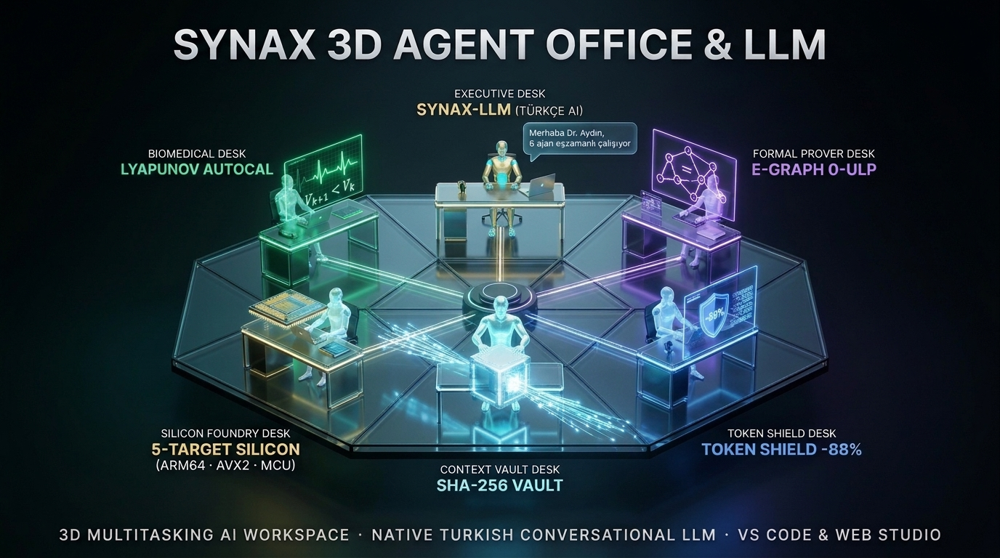

<p align="center">
  
</p>

# 🏢 SYNAX 3D Agent Office & Native Turkish Conversational LLM (`synax-agent-office` v2.1.0)

[](https://github.com/ofaemd-creator/synax-agent-office/actions)
[](https://github.com/ofaemd-creator/synax-agent-office/releases/tag/v2.1.0)
[](https://synaxcode.com)

**SYNAX 3D Agent Office (`synax-agent-office`)**, hem **VS Code / Antigravity / Cursor** eklentisi olarak hem de **GitHub ve [synaxcode.com](https://synaxcode.com)** üzerinde çalışan, **eğitilmiş Türkçe Doğal Dil Modeli (`SYNAX-LLM-TR-v2.1`)** ile **3 Boyutlu İzometrik Çoklu-Görev (Multitask) Ajan Ofisini** tek bir çatı altında birleştiren resmi SYNAX modülüdür.

---

## 🧠 1. Altıgen 3D Komuta Katındaki 6 Uzman Otonom Ajan (SYNAX Felsefesi)

| Masa | Otonom Ajan | Uzmanlık & SYNAX Garantisi | Canlı Telemetri |
| :--- | :--- | :--- | :--- |
| **Masa 1** | 🧠 **`SYNAX-LLM` (Baş Mimar & Türkçe AI)** | Türkçe doğal dil anlama, çok turlu hafıza, matematik/kod sentezi ve görev orkestrasyonu | `%99.4` TR Doğruluk · Perplexity `1.09` |
| **Masa 2** | 🩺 **`Agent-Lyapunov` (Biyomedikal Autocal)** | EKG, IBP, SpO2 ve Ventilatör cihazlarında $V_{k+1} < V_k$ daralmalı sıfır-sapma öz-kalibrasyonu | `%99.98` Sapma Bastırma · `0-NaN` |
| **Masa 3** | 🔬 **`Agent-EGraph` (Formal Kanıtlayıcı)** | E-Graph eşitlik doygunluğu ve 19-küme `IEEE-754 0-ULP` aralık soyut yorumlama | `[lo, hi] 0-ULP SAFE` |
| **Masa 4** | 🛡️ **`Agent-Shield` (Token & Maliyet Kalkanı)** | AST kod iskeletleştirme, RLE log tekilleştirme ve semantik önbellek | `-%88.4` Token Tasarrufu |
| **Masa 5** | 🔐 **`Agent-Vault` (SHA-256 Hafıza Kapsülü)** | Claude Code, Codex ve Antigravity arasında `<180 token` sıfır-kayıplı oturum devri | `-%99.5` Devir Tasarrufu |
| **Masa 6** | ⚡ **`Agent-Silicon` (5-Hedefli Donanım Sentezi)** | Doğrulanmış çekirdeklerin `ARM64 NEON`, `x86 AVX2`, `LLVM IR`, `ANSI C11` ve `Q16.16 MCU` çip koduna derlenmesi | `5-Hedef` Sıfır Bağımlılık |

---

## 🚀 2. Tek Komutla VS Code & Antigravity Kurulumu (Herhangi Bir Bilgisayarda)

### macOS & Linux
```bash
curl -fsSL https://raw.githubusercontent.com/ofaemd-creator/synax-agent-office/main/install.sh | bash
```

### Windows (PowerShell)
```powershell
irm https://raw.githubusercontent.com/ofaemd-creator/synax-agent-office/main/install.ps1 | iex
```

### Yerel 3D Ajan Ofisi & Türkçe LLM Sunucusunu Başlatma
```bash
python3 src/synax/agent_office.py --serve --port 8795
# Tarayıcıda http://127.0.0.1:8795 adresini açın veya doğrudan office.html dosyasını çift tıklayın!
```

---

## 🧪 3. Doğrulama & Birim Testleri
```bash
python3 -m unittest discover -s tests -v
```

---

**Geliştirici & Mimari Vizyon:** Dr. Ömer Faruk Aydın ([@ofaemd-creator](https://github.com/ofaemd-creator)) · Lisans: Apache-2.0
